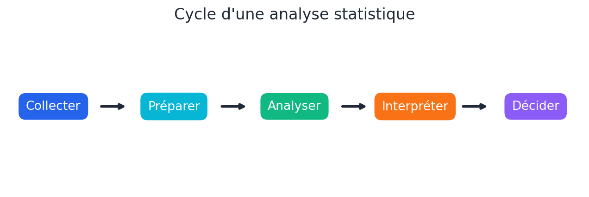
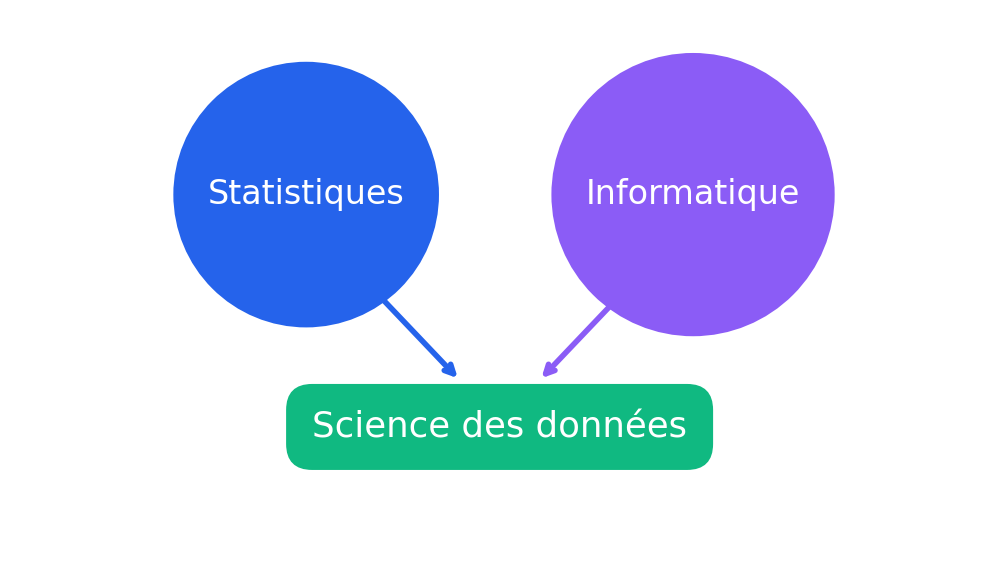
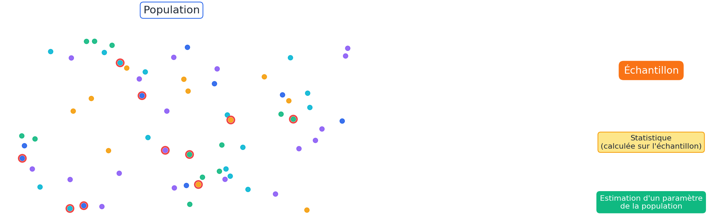
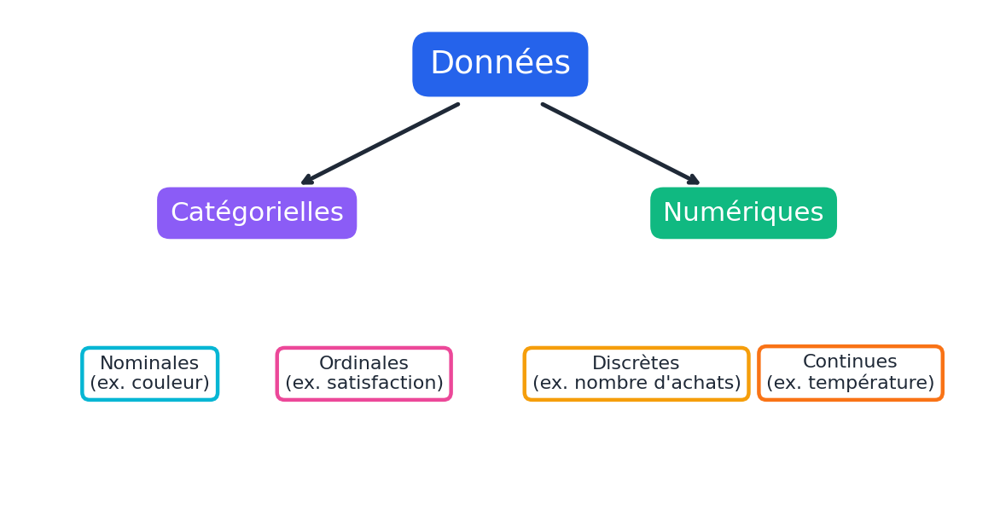
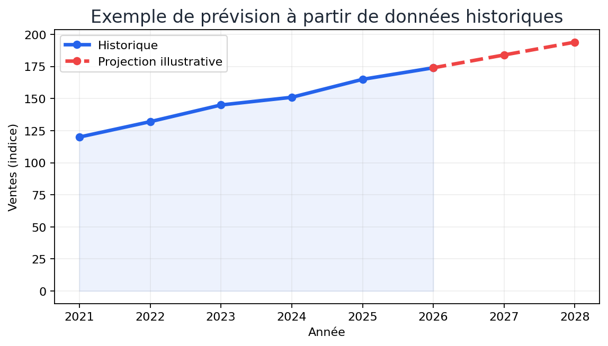
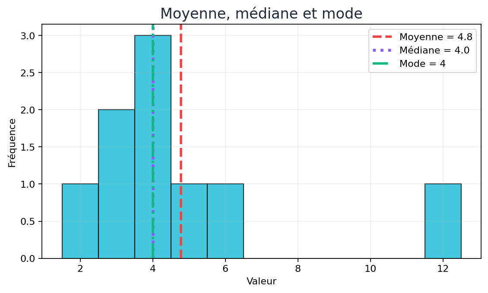
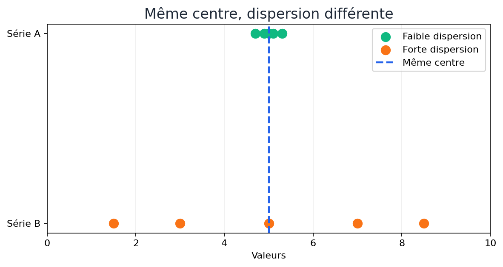
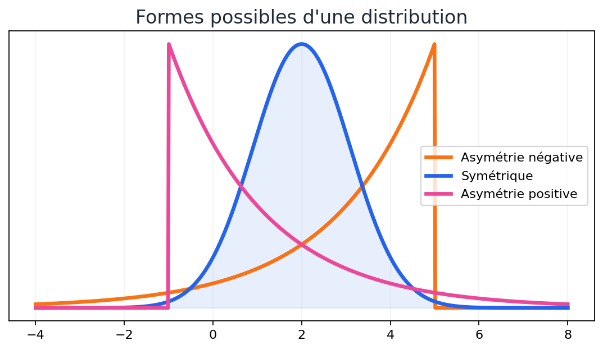
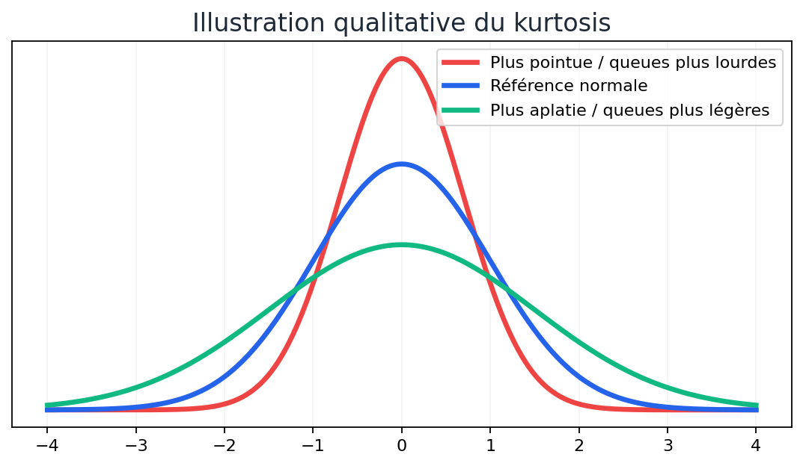
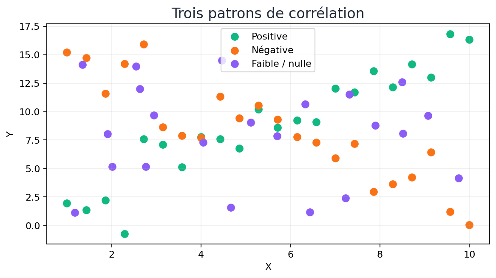

# Fondamentaux des statistiques

Ce notebook introduit les notions statistiques essentielles utilisées en analyse de données et en science des données.

## Objectifs d'apprentissage

À la fin de ce notebook, on devrait être capable de :

- distinguer **population**, **échantillon**, **paramètre** et **statistique** ;
- reconnaître les principaux **types de données** ;
- calculer et interpréter la **moyenne**, la **médiane** et le **mode** ;
- mesurer la **dispersion** à l'aide de l'étendue, de l'IQR, de la variance et de l'écart-type ;
- décrire la **forme d'une distribution** avec l'asymétrie et le kurtosis ;
- interpréter une **covariance** et une **corrélation**.

## __Plan du cours__

Dans cette leçon, nous aborderons les concepts suivants à l'aide d'exemples :
* Importance des statistiques en science des données :
  * Qu'est-ce que la statistique ?
  * Termes couramment utilisés en statistique
  * Types de statistiques
* Types de données
* Mesures de tendance centrale
* Mesures de dispersion
  * Étendue
  * Écart interquartile
  * Écart-type
  * Variance
* Mesures de forme
  * Asymétrie
  * Kurtosis
* Covariance et corrélation

## __1. Importance des statistiques en science des données__

La plupart des avancées majeures en statistique ont eu lieu au cours du siècle dernier. La théorie des probabilités, qui constitue l'un des fondements de la statistique, a notamment été développée entre les XVIIe et XIXe siècles par Thomas Bayes, Pierre-Simon Laplace et Carl Gauss. Alors que la théorie des probabilités est de nature théorique, la statistique est une branche appliquée des sciences dont l'objectif principal est d'analyser les données.

Dans cette leçon, nous explorerons différents concepts statistiques ainsi que leur importance en science des données.

- La première étape de tout projet de science des données consiste à explorer les données.
- La statistique classique se concentre principalement sur l'inférence, c'est-à-dire un ensemble de méthodes permettant de tirer des conclusions sur de grandes populations à partir de l'étude de petits échantillons.

Le développement rapide des nouvelles technologies, l'accès à des volumes de données plus importants et l'utilisation croissante de l'analyse quantitative dans de nombreuses disciplines ont favorisé cette évolution.

### __1.1 Qu'est-ce que la statistique ?__

La statistique regroupe les méthodes permettant de **recueillir, préparer, analyser et interpréter des données** afin d'en tirer des conclusions utiles.



Ces résultats sont ensuite combinés à l'expertise du domaine afin d'interpréter les tendances observées et de les utiliser pour prendre des décisions dans des situations réelles. L'objectif final est de générer de la valeur pour une organisation.

La science des données s'appuie notamment sur la **statistique** et l'**informatique**. La statistique aide à résumer, comparer et interpréter les données, tandis que l'informatique permet de les traiter efficacement à grande échelle.



### __1.2 Termes couramment utilisés en statistique__

- **Population** : ensemble complet sur lequel porte l'étude.
- **Échantillon** : sous-ensemble de la population utilisé pour réaliser l'analyse.
- **Paramètre** : caractéristique numérique de la population, par exemple sa moyenne.
- **Statistique** : quantité calculée à partir d'un échantillon, par exemple la moyenne de l'échantillon.
- **Variable** : caractéristique observée pouvant prendre différentes valeurs.
- **Distribution** : manière dont les valeurs d'une variable se répartissent.

### __1.3 Types de statistiques__

### Population et échantillon



L'objectif de l'inférence statistique est souvent d'utiliser une **statistique calculée sur un échantillon** pour estimer ou tester un **paramètre de la population**.

#### Statistique descriptive

La statistique descriptive sert à **organiser, résumer et présenter** les données observées. Elle utilise notamment des tableaux, des graphiques et des mesures comme la moyenne ou l'écart-type.

#### Statistique inférentielle

La statistique inférentielle utilise les données d'un **échantillon** pour tirer des conclusions sur une **population**.

> **À retenir :** la statistique descriptive décrit les données disponibles; la statistique inférentielle cherche à généraliser au-delà de l'échantillon.

#### __Exemple__

#### Exemple — contrôle de qualité

Une usine fabrique plusieurs milliers de composants par mois.

- **Population** : tous les composants fabriqués durant le mois.
- **Échantillon** : 100 composants sélectionnés pour inspection.
- **Paramètre** : proportion réelle de composants conformes dans toute la production.
- **Statistique** : proportion de composants conformes parmi les 100 inspectés.

La statistique descriptive permet de résumer les résultats de l'échantillon. La statistique inférentielle permet ensuite d'utiliser ces résultats pour estimer la qualité de l'ensemble de la production.

- #### <b> Statistique prédictive</b>

Elle est définie comme la science qui consiste à extraire de l'information à partir des données et à utiliser cette information pour prévoir des tendances, des comportements ou des relations entre différentes caractéristiques.

#### __Exemple 1__

Les données enregistrant le nombre d'habitants d'une ville sur plusieurs années peuvent être utilisées pour prédire sa population future. Cette prévision est utile pour estimer les besoins futurs en infrastructures. Souvent, les données concernant deux caractéristiques ou plus présentent des relations. Comprendre ces relations permet de prédire une caractéristique à partir des valeurs connues d'une autre.

### Classification des types de données



#### __Exemple 2__

La demande de pièces de rechange pour les prochaines années peut être prédite en analysant les ventes de voitures des dernières années.

### Exemple — statistique prédictive

Une série historique de ventes peut servir à construire un modèle qui estime les ventes futures.



> La partie en pointillés est une **illustration** d'une projection. Une vraie prévision doit être produite par une méthode ou un modèle explicite et accompagnée d'une mesure d'incertitude.

## __2. Types de données__

#### 2.1 Données catégorielles

Les données catégorielles représentent des **catégories ou des qualités**.

- **Nominales** : catégories sans ordre naturel, par exemple la couleur ou le type d'appareil.
- **Ordinales** : catégories possédant un ordre, par exemple *faible*, *moyen*, *élevé*.

Une catégorie peut être codée par un nombre, mais ce nombre n'a pas nécessairement de signification arithmétique.

#### 2.2 Données numériques

Les données numériques représentent des **quantités mesurables ou comptables**.

- **Discrètes** : valeurs généralement issues d'un comptage, par exemple le nombre de commandes.
- **Continues** : valeurs issues d'une mesure, par exemple la température, la taille ou la durée.

## __3. Mesures de tendance centrale__

Une mesure de tendance centrale résume la position du **centre** d'une distribution.

Les trois mesures les plus courantes sont :

- la **moyenne** ;
- la **médiane** ;
- le **mode**.



> Une seule mesure ne suffit pas toujours : le choix dépend de la forme des données et de la présence éventuelle de valeurs aberrantes.

### <b> 3.1 Moyenne</b>
Il s'agit de la mesure de tendance centrale la plus fréquemment utilisée. Elle peut être appliquée aussi bien à des données continues qu'à des données discrètes.

Pour calculer la moyenne, on additionne toutes les valeurs du jeu de données, puis on divise le résultat par le nombre total de valeurs.

<b> Remarque : </b>La moyenne est sensible aux valeurs aberrantes et aux distributions asymétriques.

Supposons qu'un ensemble contienne n nombres. La moyenne de cet ensemble est calculée en additionnant toutes les valeurs, puis en divisant la somme obtenue par n, soit le nombre d'éléments de l'ensemble. La formule de la moyenne est la suivante :

### Formule de la moyenne

Pour un échantillon de `n` observations :

\[
\bar{x} = \frac{1}{n}\sum_{i=1}^{n}x_i
\]

La moyenne additionne toutes les observations puis divise la somme par leur nombre.

#### Exemple

Pour les valeurs :

`4, 89, 54, -7, -9, 27, 5`

la moyenne est :

\[
ar{x} = rac{4+89+54-7-9+27+5}{7}
       = rac{163}{7}
       pprox 23{,}29
\]

Cet exemple montre aussi qu'une valeur élevée comme `89` peut influencer fortement la moyenne.

### __Implémentation du calcul de la moyenne en Python__

```python
import statistics

x = [4, 89, 54, -7, -9, 27, 5]
moyenne = statistics.mean(x)
moyenne
```

### <b> 3.2 Médiane </b>
La médiane correspond à la valeur centrale obtenue lorsque les données sont classées par ordre croissant ou décroissant.

- Dans un jeu de données contenant un nombre impair de valeurs, la médiane correspond exactement à la valeur du milieu.
- Dans un jeu de données contenant un nombre pair de valeurs, la médiane correspond à la moyenne des deux valeurs centrales.
- Dans les deux cas, la médiane est beaucoup moins sensible aux valeurs aberrantes et aux distributions asymétriques.

<b> Exemple 1</b>

Considérons le jeu de données contenant un nombre impair de valeurs : x = 5, 76, 98, 32, 1, -6, 34, 3, -65

Étape 1 : Classer les nombres par ordre croissant : -65, -6, 1, 3, 5, 32, 34, 76, 98

Étape 2 : La valeur centrale est la cinquième, puisqu'il y a neuf nombres au total. La médiane du jeu de données est donc 5.

<b> Exemple 2</b>

Considérons le jeu de données contenant un nombre pair de valeurs : x = 5, 76, 98, 32, 1, -6, 34, 3, -65, 99

Étape 1 : Classer les nombres par ordre croissant : -65, -6, 1, 3, 5, 32, 34, 76, 98, 99

Étape 2 : Identifier les deux valeurs centrales : 5 et 32.

Étape 3 : Pour calculer la médiane, prendre la moyenne des deux valeurs centrales, soit 5 et 32. La médiane du jeu de données est donc (5+32)/2 = 18.5.

### __Implémentation du calcul de la médiane en Python__

```python
x = [1, 2, 3, 4, 5, 6, 7, 8, 9, 10]
statistics.median(x)
```

### <b> 3.3 Mode </b>
Le mode correspond à la valeur qui apparaît le plus souvent dans un jeu de données.

- Le mode est flexible et peut être utilisé avec des données numériques ou catégorielles.
- Le mode peut parfois être trompeur et ne pas représenter correctement le véritable centre d'une distribution.
- Il peut aussi être éloigné du centre réel lorsqu'une valeur fréquente se situe loin de la majorité des observations.

**Exemple :** Recueillir les préférences de marques de téléphones cellulaires auprès de 100 personnes afin d'analyser les données catégorielles et d'en tirer des conclusions.

<b> Marque préférée</b> $\;\;\;\;\;\;$ <b>Nombre de personnes</b>

Nokia $\;\;\;\;\;\;\;\;\;\;\;\;\;\;\;\;\;\;\;\;\;$  12

Realme $\;\;\;\;\;\;\;\;\;\;\;\;\;\;\;\;\;\;$ 32

Apple $\;\;\;\;\;\;\;\;\;\;\;\;\;\;\;\;\;\;\;\;$  10

Samsung $\;\;\;\;\;\;\;\;\;\;\;\;\;\;\;\;$    36

Oppo  $\;\;\;\;\;\;\;\;\;\;\;\;\;\;\;\;\;\;\;\;$   4

Vivo  $\;\;\;\;\;\;\;\;\;\;\;\;\;\;\;\;\;\;\;\;\;$   6

Dans les données ci-dessus, la préférence la plus fréquente est Samsung, ce qui correspond au mode.

### __Implémentation du calcul du mode en Python__

```python
x = ['Nokia', 'Samsung', 'Samsung', 'Apple', 'Oppo', 'Vivo']
statistics.mode(x)
```

## __4. Mesures de dispersion__

Les mesures de dispersion décrivent **à quel point les observations sont éloignées les unes des autres ou du centre**.

Deux séries peuvent avoir la même moyenne tout en ayant des dispersions très différentes.



### <b>4.1 Étendue</b>
L'étendue correspond à la différence entre la plus grande et la plus petite valeur d'un jeu de données. Elle est sensible aux valeurs aberrantes et ne tient pas compte de l'ensemble des observations. Elle fournit également les valeurs maximale et minimale du jeu de données.

Puisqu'elle repose uniquement sur deux observations extrêmes, elle est fortement influencée par les fluctuations. L'étendue n'est donc pas une mesure de dispersion très fiable.

<div style="text-align:center">$Étendue = X_{max}$ – $X_{min}$</div>

### <b>4.2 Écart interquartile</b>
L'écart interquartile correspond à la différence entre le 25e et le 75e percentile.

- Il décrit les 50 % centraux des observations. Plus ces observations sont éloignées les unes des autres, plus l'écart interquartile est élevé.
- Il demeure utile même lorsque les valeurs extrêmes ne sont pas fiables, puisqu'il y est peu sensible.
- Il se prête difficilement aux manipulations mathématiques.

<div style="text-align:center"><b>$IQR = Q_3 – Q_1$</b></div>

**Exemple** :
Considérons le jeu de données suivant, dont les valeurs sont classées par ordre croissant :
[10, 15, 20, 25, 30, 35, 40, 50, 70, 100]

Le 25e percentile = moyenne des 2e et 3e valeurs = (15 + 20)/2 = 17.5.

Le 75e percentile = moyenne des 7e et 8e valeurs = (40 + 50)/2 = 45.

L'écart interquartile = 45 - 17.5 = 27.5.

### 4.3 Écart-type

L'écart-type mesure la dispersion des observations autour de la moyenne.

- Un **petit écart-type** indique que les valeurs sont regroupées près de la moyenne.
- Un **grand écart-type** indique qu'elles sont davantage dispersées.

Pour une population :

\[
\sigma = \sqrt{rac{1}{N}\sum_{i=1}^{N}(x_i-\mu)^2}
\]

Pour un échantillon, on utilise généralement `n - 1` au dénominateur.

### Formule de l'écart-type d'une population

\[
\sigma = \sqrt{\frac{1}{N}\sum_{i=1}^{N}(x_i-\mu)^2}
\]

L'écart-type est exprimé dans la **même unité que les données**, contrairement à la variance.

### __Implémentation du calcul de l'écart-type en Python__

```python
x = [1, 2, 3, 4, 5]

print("Écart-type population :", statistics.pstdev(x))
print("Écart-type échantillon :", statistics.stdev(x))
```

### 4.4 Variance

La variance correspond à la moyenne des **écarts au carré** par rapport à la moyenne.

Pour une population :

\[
\sigma^2 = rac{1}{N}\sum_{i=1}^{N}(x_i-\mu)^2
\]

L'écart-type est simplement la racine carrée de la variance.

### __Implémentation du calcul de la variance en Python__

```python
x = [1, 2, 3, 4, 5]

print("Variance population :", statistics.pvariance(x))
print("Variance échantillon :", statistics.variance(x))
```

### __4.5 Écart-type et variance pour une population et un échantillon__

### 4.5 Population ou échantillon ?

La formule utilisée dépend du contexte :

| Mesure | Population | Échantillon |
|---|---:|---:|
| Variance | division par `N` | division par `n - 1` |
| Écart-type | racine de la variance population | racine de la variance échantillon |

En Python, le module `statistics` distingue explicitement les deux cas :

```python
statistics.pvariance(x)   # population
statistics.variance(x)    # échantillon

statistics.pstdev(x)      # population
statistics.stdev(x)       # échantillon
```

## __5. Mesures de forme (asymétrie)__

### __5.1 Qu'est-ce que l'asymétrie ?__

L'**asymétrie** (*skewness*) décrit le manque de symétrie d'une distribution.

- asymétrie **négative** : queue plus longue vers les petites valeurs ;
- distribution **symétrique** : les deux côtés sont comparables ;
- asymétrie **positive** : queue plus longue vers les grandes valeurs.



#### __Formule de l'asymétrie__

Pour une variable univariée $X_1,X_2,.....X_n$, l'asymétrie est donnée par :

#### Une formule courante de l'asymétrie

Pour une variable \(X\), le coefficient d'asymétrie basé sur le troisième moment standardisé peut s'écrire :

\[
\gamma_1 =
\frac{E[(X-\mu)^3]}{\sigma^3}
\]

- \(\gamma_1 < 0\) : asymétrie négative ;
- \(\gamma_1 \approx 0\) : distribution approximativement symétrique ;
- \(\gamma_1 > 0\) : asymétrie positive.

Dans une distribution parfaitement symétrique, la moyenne et la médiane sont généralement proches.

Une longue queue à droite tend à produire une **asymétrie positive**; une longue queue à gauche tend à produire une **asymétrie négative**.

> L'asymétrie décrit la forme d'une distribution; elle ne dit pas, à elle seule, si les données sont « bonnes » ou « mauvaises ».


### __Implémentation du calcul de l'asymétrie en Python__

```python
import pandas as pd

x = pd.Series([1, 2, 3, 4, 7, 8])

asymetrie = x.skew()
print("Asymétrie :", asymetrie)
```

### __5.2 Mesures de forme (kurtosis)__

Le **kurtosis** décrit notamment le poids relatif des queues d'une distribution et sa propension à produire des valeurs extrêmes.

- un kurtosis plus élevé est associé à des **queues plus lourdes** ;
- un kurtosis plus faible est associé à des **queues plus légères**.



#### __Formule du kurtosis__

Pour une variable univariée $X_1,X_2,.....X_n$, le kurtosis est donné par :

#### Une formule courante du kurtosis

Le kurtosis basé sur le quatrième moment standardisé s'écrit :

\[
\beta_2 =
\frac{E[(X-\mu)^4]}{\sigma^4}
\]

Pour l'**excès de kurtosis**, on soustrait `3` :

\[
\gamma_2 = \beta_2 - 3
\]

Ainsi, la distribution normale possède un excès de kurtosis égal à `0`.

Lorsqu'on utilise l'**excès de kurtosis**, la distribution normale sert de référence avec une valeur de `0`.

- valeur positive : queues relativement plus lourdes ;
- valeur négative : queues relativement plus légères.


### __Implémentation du calcul du kurtosis en Python__

```python
import pandas as pd

x = pd.Series([2, 4, 5, 7, 8, 9, 11, 15])

# pandas.Series.kurt() retourne l'excès de kurtosis
kurtosis = x.kurt()
print("Excès de kurtosis :", kurtosis)
```

## __6. Covariance et corrélation__

La **covariance** et la **corrélation** décrivent la relation entre deux variables numériques.

- La **covariance** indique surtout la direction de la relation.
- La **corrélation** standardise cette relation sur une échelle allant de `-1` à `1`.



### __6.1 Covariance__

Si E[x] représente l'espérance mathématique ou la moyenne de l'échantillon x, la covariance de x et y est donnée par :

### Formule générale de la covariance

Pour deux variables aléatoires \(X\) et \(Y\) :

\[
\operatorname{Cov}(X,Y)
=
E[(X-\mu_X)(Y-\mu_Y)]
\]

- covariance positive : les variables ont tendance à évoluer dans le même sens ;
- covariance négative : elles ont tendance à évoluer en sens opposé ;
- covariance proche de zéro : absence de relation linéaire marquée, sans exclure une relation non linéaire.

### __Formule de la covariance pour une population__

### Formule de la covariance pour une population

\[
\operatorname{Cov}(X,Y)
=
rac{1}{N}
\sum_{i=1}^{N}(x_i-\mu_x)(y_i-\mu_y)
\]

### __Formule de la covariance pour un échantillon__

### Formule de la covariance pour un échantillon

\[
s_{xy}
=
rac{1}{n-1}
\sum_{i=1}^{n}(x_i-ar{x})(y_i-ar{y})
\]

Où :

$x_i$ représente la $i^{e}$ observation de la variable x.

$\bar{x}$ représente la moyenne de la variable x.

$y_i$ représente la $i^{e}$ observation de la variable y.

$\bar{y}$ représente la moyenne de la variable y.

N représente le nombre d'observations.

### __Implémentation en Python de la covariance entre deux variables__

```python
import pandas as pd

df = pd.DataFrame({
    'x': [1, 2, 3, 4, 5],
    'y': [5, 4, 3, 2, 1]
})

cov_xy = df['x'].cov(df['y'])
cov_xy
```

Cette valeur négative indique que lorsque les valeurs de `x` augmentent, les valeurs de `y` ont tendance à diminuer, et inversement.

### __6.2 Corrélation__

Le coefficient de corrélation est souvent appelé coefficient de corrélation de Pearson.

Le coefficient de corrélation entre deux variables est calculé en divisant leur covariance par le produit de leurs écarts-types respectifs. Puisque l'écart-type mesure la variabilité absolue, ou la dispersion, d'une distribution de données, cette division par le produit des écarts-types permet de normaliser le coefficient de corrélation afin qu'il soit compris entre -1 et +1.

#### __Formule du coefficient de corrélation__

#### Formule du coefficient de corrélation

\[
r = rac{\operatorname{Cov}(X,Y)}{s_X s_Y}
\]

Le coefficient `r` varie entre `-1` et `1`.

- `r ≈ 1` : forte relation linéaire positive ;
- `r ≈ -1` : forte relation linéaire négative ;
- `r ≈ 0` : faible relation linéaire.

> **Attention : corrélation ne signifie pas causalité.**

Où :

$S_x$, $S_y$ représentent respectivement les écarts-types de x et de y.

### __Implémentation en Python du coefficient de corrélation entre deux variables__

```python
correlation_xy = df['x'].corr(df['y'])
correlation_xy
```

Cette valeur indique une relation linéaire négative parfaite entre `x` et `y` : lorsque `x` augmente, `y` diminue proportionnellement, et inversement.

---

> **Note Hugo :** cette page utilise des formules LaTeX entre `\[` `\]` et `\(` `\)`.  
> Le thème Hugo doit avoir MathJax ou KaTeX activé pour les afficher correctement.
