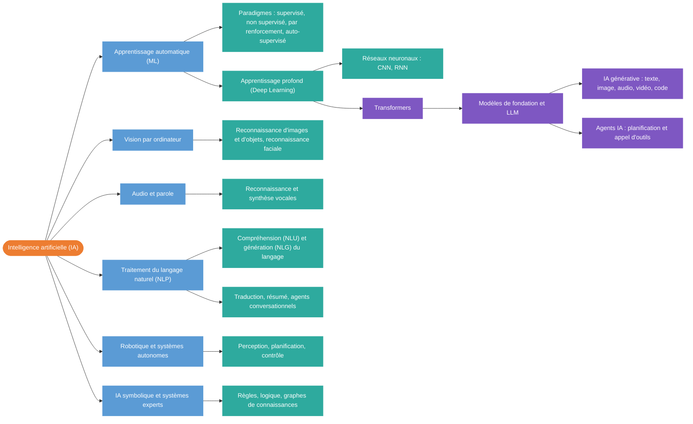

+++
date = '2025-12-03T09:43:36-05:00'
draft = false
title = "📘 Introduction à l’intelligence artificielle"
weight = 121
+++

## 1. **Définition de l'IA**

- **Qu'est-ce que l'intelligence artificielle ?**
L'IA désigne la capacité d'une machine à imiter l'intelligence humaine, en apprenant, en résolvant des problèmes, en comprenant des langages, et même en prenant des décisions.
    
    

    *Exemples d'IA étroite datant de 2016-2017 (Siri, Tesla Autopilot, AlphaGo contre Ke Jie, bras robotisé jouant aux échecs, Amazon Echo). Source : Simplilearn.*
    

### **Types d'IA :**

- **IA faible (ou étroite) ou** **Artificial Narrow Intelligence (ANI)** : Conçue pour effectuer des tâches spécifiques (ex. : assistants vocaux, reconnaissance faciale). Elle ne possède aucune capacité de raisonnement ou de compréhension au-delà de cette tâche particulière.
- **IA forte (ou générale) ou Artificial General Intelligence (AGI) :** Hypothétique, capable d'accomplir toute tâche intellectuelle qu'un humain peut faire. Elle fait référence à une machine capable d'apprendre et de comprendre des tâches de manière autonome, de manière similaire à un humain. Contrairement à l'ANI, l'AGI possède une capacité de raisonnement, de compréhension et d'adaptation à des contextes variés et nouveaux. Elle pourrait effectuer toutes les tâches cognitives qu'un être humain pourrait accomplir.
- **IA super-intelligente ou Artificial Superintelligence (ASI) :** Elle fait référence à une forme d'intelligence artificielle qui surpasserait l'intelligence humaine dans tous les domaines, y compris la créativité, la résolution de problèmes, la prise de décision, et les capacités émotionnelles et sociales.

#### Comparaison : ANI vs AGI vs ASI

| **Type d'IA** | **Capacité** | **Exemple** | **Statut** |
| --- | --- | --- | --- |
| **ANI** (Artificial Narrow Intelligence) | Excellente dans une tâche spécifique, mais limitée à cette tâche. | Systèmes de recommandation, reconnaissance faciale, voitures autonomes, assistants basés sur des LLM (ChatGPT, Claude, Gemini). | Existe aujourd'hui. |
| **AGI** (Artificial General Intelligence) | Capacité à comprendre, apprendre, et s'adapter à tout type de tâche cognitive. | IA de science-fiction, robots capables de raisonnement général. | Hypothétique. Les prévisions varient fortement : certains laboratoires parlent de la fin des années 2020 ou des années 2030, de nombreux chercheurs sont beaucoup plus prudents. |
| **ASI** (Artificial Superintelligence) | Intelligence supérieure à l'humain dans tous les domaines. | Machines qui surpassent l'intelligence humaine. | Hypothétique, aucune échéance consensuelle. |

> Les grands modèles de langage (LLM) actuels sont polyvalents, mais ils restent classés comme de l'IA étroite : leur « compréhension » et leur fiabilité sont limitées, et ils ne constituent pas une AGI.

## 2. **Histoire et évolution de l'IA**

### **Origines de l'IA :**

De l'idée de Turing à la création du premier ordinateur.

#### Test de Turing

test de Turing, introduit par Alan Turing dans les années 1950 pour déterminer si une machine peut penser de manière similaire à un humain. Le test se présente comme un jeu où une machine et un humain interagissent avec un juge, ce dernier devant déterminer lequel est l'humain et lequel est la machine. Si la machine réussit à tromper le juge en se faisant passer pour un humain, elle a "réussi" le test.

En 2025, une étude de l'Université de Californie à San Diego a montré que, dans un test de Turing à trois participants, un LLM (GPT-4.5, avec une consigne de personnage) était identifié comme l'humain plus souvent que le véritable humain. Ce résultat relance le débat sur la valeur du test comme mesure de l'intelligence : il évalue la capacité d'imitation, pas la compréhension.

Source : https://miro.medium.com/v2/resize:fit:828/format:webp/1*b7t43chAkw3il-hBnBtWow.jpeg

#### **Les étapes clés :**

Les premiers systèmes experts, l'apprentissage machine, les réseaux neuronaux, et l'avènement de l'IA moderne.

| Année | Événement |
| --- | --- |
| 1950 | Alan Turing publie « Computing Machinery and Intelligence » et propose le test de Turing. |
| 1956 | Conférence de Dartmouth : le terme « intelligence artificielle » est adopté. |
| 1980-1990 | Systèmes experts, puis « hiver de l'IA » (baisse des financements). |
| 2012 | AlexNet remporte ImageNet : le deep learning s'impose en vision par ordinateur. |
| 2016 | AlphaGo bat Lee Sedol au jeu de Go. |
| 2017 | Publication de l'architecture **Transformer** (« Attention Is All You Need »). |
| 2020 | GPT-3 démontre les capacités des grands modèles de langage. |
| 2022 | Lancement de ChatGPT (novembre) : l'IA générative atteint le grand public. |
| 2023-2025 | Modèles multimodaux, modèles de raisonnement, agents IA, essor des modèles ouverts (Llama, Mistral, DeepSeek). |
| 2024 | Prix Nobel de physique (Hinton, Hopfield) et de chimie (Hassabis, Jumper, Baker, pour AlphaFold) liés à l'IA. |

Source : https://www.justai.co/articles-de-blog/intelligence-artificielle

## 3. **Sous-domaines de l'IA**

- **Apprentissage supervisé et non supervisé :** Différence entre l'apprentissage à partir de données étiquetées et non étiquetées.
- **Apprentissage par renforcement :** Comment une machine apprend à travers l'essai et l'erreur (exemple : jeux comme Go ou échecs).
- **Traitement du langage naturel (NLP) :** Comprendre et générer du langage humain (ex. : chatbots, traduction automatique).
- **Vision par ordinateur :** Permet aux machines de voir et d'interpréter des images.
- **IA générative et modèles de fondation :** Grands modèles préentraînés (souvent par apprentissage auto-supervisé) qui génèrent du texte, des images, du son ou du code et s'adaptent à de nombreuses tâches.
- **Systèmes agentiques :** Modèles capables de planifier et d'enchaîner des actions en appelant des outils (API, navigateur, code) pour accomplir un objectif.

## 4. **Méthodes et algorithmes en IA**

- **Algorithmes classiques :** Recherche, optimisation, et méthodes logiques.
- **Apprentissage automatique (machine learning) :** Les bases de l'entraînement des modèles à partir de données.
- **Réseaux neuronaux et Deep Learning :** Introduction aux réseaux multicouches et à l'IA moderne, utilisée dans des domaines comme la reconnaissance vocale et l'image.
- **Transformers et grands modèles de langage (LLM) :** Architecture basée sur le mécanisme d'attention, à l'origine de GPT, Claude, Gemini, Llama ou Mistral. Les LLM prédisent le mot (token) suivant à partir d'un contexte, puis sont affinés (fine-tuning, apprentissage par renforcement avec rétroaction humaine).
- **Techniques d'utilisation des LLM :** Ingénierie de prompt, RAG (*Retrieval-Augmented Generation*, génération augmentée par recherche dans des documents) et appel d'outils.

## 5. **Applications de l'IA**

- **Dans le quotidien :** Assistants virtuels (ex. : Siri, Alexa, désormais enrichis par des LLM comme Apple Intelligence ou Alexa+), assistants conversationnels (ChatGPT, Claude, Gemini, Copilot), recommandations (ex. : Netflix), voitures autonomes et robotaxis.
- **Dans l'industrie :** Diagnostic médical, prévisions financières, maintenance prédictive, assistants de programmation, service à la clientèle automatisé.
- **Dans la recherche :** Découverte de médicaments, prédiction de la structure des protéines (AlphaFold), analyse de données complexes.

## 6. **Tendances futures**

### **L'IA générative :**

L'**IA générative** désigne des modèles d'intelligence artificielle capables de créer de nouveaux contenus (textes, images, vidéos, musique, etc.) à partir de données d'entraînement. Voici un résumé des concepts clés associés à l'IA générative :

#### **Principes de base** :

L'IA générative utilise des algorithmes d'apprentissage machine, notamment des réseaux de neurones, pour apprendre à partir de grandes quantités de données et générer de nouvelles créations similaires aux exemples fournis.

#### **Types de modèles** :

- **Modèles de langage (LLM) (ex. GPT d'OpenAI, Claude d'Anthropic, Gemini de Google, Llama de Meta, Mistral, DeepSeek)** : Génèrent des textes cohérents et contextuels, répondent à des questions, rédigent des articles, écrivent du code ou génèrent des dialogues. Plusieurs sont **multimodaux** (texte, image, audio).
- **Modèles de génération d'images (ex. Midjourney, Stable Diffusion, modèles d'images intégrés à ChatGPT et Gemini)** : Produisent des images à partir de descriptions textuelles, la plupart par diffusion.
- **Modèles de musique (ex. Suno)** : Génèrent des chansons complètes (paroles et voix incluses) à partir d'un prompt. Les outils du secteur se sont réorientés vers des modèles sous licence après les poursuites des maisons de disques (ex. : accords de Suno avec Warner et BMG, et d'Udio avec Universal).
- **Modèles vidéo (ex. Veo de Google, Runway, Kling, Seedance, Synthesia)** : Créent des vidéos à partir de texte ou d'images, ou des avatars présentateurs. Le marché évolue vite : OpenAI a par exemple arrêté son outil Sora en 2026.

Ces outils soulèvent aussi des questions de droit d'auteur (litiges sur les données d'entraînement) et de propriété des contenus générés.

#### **Applications** :

- **Création de contenu** : Rédaction automatisée d'articles, génération d'images pour le design, création de musique.
- **Personnalisation** : Création de recommandations de produits, génération de publicités personnalisées, ou contenu sur mesure pour les utilisateurs.
- **Amélioration des processus créatifs** : Utilisation de l'IA pour assister les artistes, écrivains, musiciens dans leur travail en générant des idées, des maquettes ou des prototypes.

### **L'IA explicable :**

L'**IA explicable** (XAI) vise à rendre les modèles d'intelligence artificielle transparents et compréhensibles pour les humains. Contrairement aux systèmes "boîte noire", elle permet de comprendre pourquoi un modèle fait une certaine prédiction, renforçant ainsi la confiance, la responsabilité et la conformité aux régulations comme le RGPD. Les techniques incluent des modèles simples, des méthodes post-hoc comme LIME et SHAP, et des mécanismes d'attention. L'IA explicable est cruciale dans des domaines sensibles comme la santé, la finance et la justice, mais elle présente des défis, notamment le compromis entre précision et interprétabilité. Son objectif est de rendre l'IA plus accessible, éthique et fiable.

### **Autres tendances :**

- **Agents IA :** Systèmes qui planifient et exécutent des tâches en plusieurs étapes en utilisant des outils et des API (ex. : agents de programmation, protocole MCP pour connecter les modèles aux outils).
- **Modèles de raisonnement :** Modèles qui « réfléchissent » avant de répondre (ex. : o1 et o3 d'OpenAI, DeepSeek-R1), meilleurs en mathématiques et en programmation.
- **RAG :** Associer un LLM à des documents ou bases de données de l'organisation pour limiter les hallucinations et utiliser des données à jour.
- **Modèles ouverts et petits modèles :** Modèles à poids ouverts exécutables localement, utiles pour la confidentialité et les coûts.
- **Réglementation et gouvernance :** Mise en application progressive de l'AI Act (transparence depuis août 2026, haut risque en 2027-2028), exigences d'étiquetage des contenus générés et d'évaluation des risques, tensions entre lois d'États et politique fédérale aux États-Unis.

## Ressources :

[Intelligence artificielle : définition, histoire et application](https://www.justai.co/articles-de-blog/intelligence-artificielle)

[EU Artificial Intelligence Act](https://artificialintelligenceact.eu/)

[OWASP Top 10 for LLM Applications](https://genai.owasp.org/)